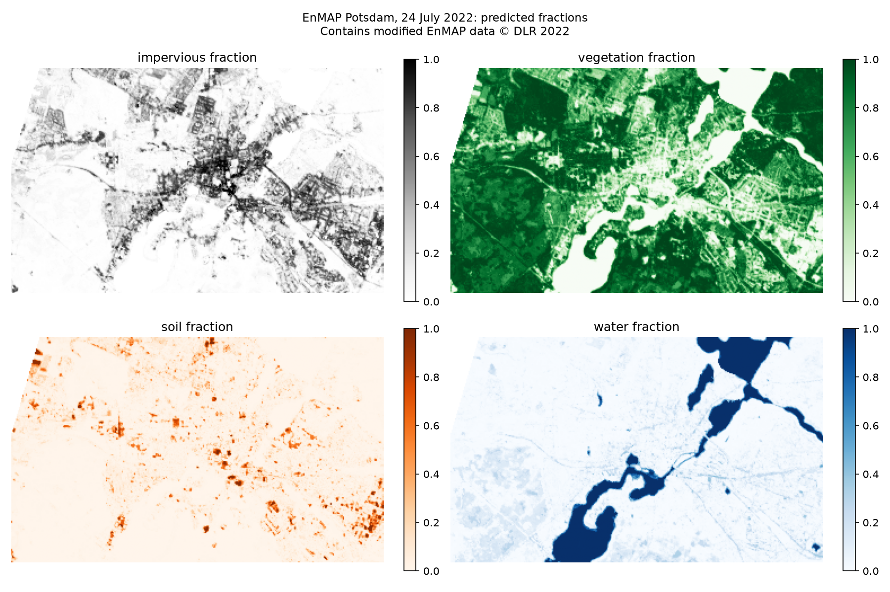
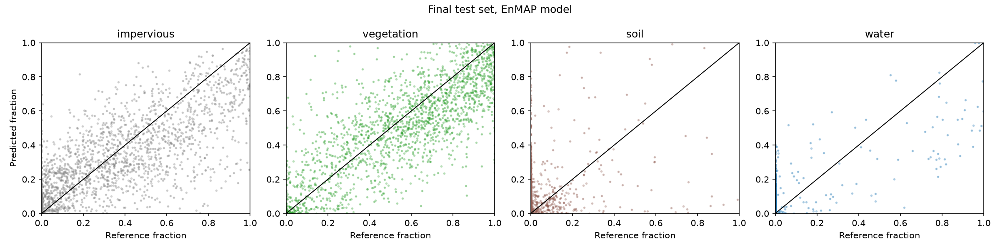

# Urban land cover fractions from EnMAP: Potsdam

How much of each 30 m EnMAP pixel is vegetation, sealed surface, soil or water? And does a hyperspectral satellite do this better than Sentinel-2?

This project estimates land cover **fractions** from a real EnMAP L2A scene of Potsdam with regression-based unmixing and synthetically mixed training data (following Okujeni et al. 2013), validates them against a 1 m reference, and compares the result with simulated Sentinel-2 data.



*Contains modified EnMAP data © DLR 2022.*

## Approach

1. **Band quality check.** The file flags 6 bands as bad. The mean spectrum showed more problems: oxygen and water vapour absorptions, an unstable VNIR detector edge and noise above 2400 nm, matching the known issues in the EnMAP validation (Brell et al. 2026). 185 of 224 bands are kept.
2. **Reference fractions.** Land cover polygons from a 1 m aerial image are rasterised on a 1 m grid aligned with the EnMAP pixels. The share of each class in the 30 × 30 cells gives the reference fraction for 5,422 fully covered pixels.
3. **Spectral library.** Pure pixels per class, cleaned with NDVI rules because the reference (April 2019) and the image (July 2022) are three years apart.
4. **Synthetic mixing and Random Forest.** 10,000 synthetic mixtures of 1 to 3 classes with random fractions. One Random Forest predicts all four fractions. Class frequencies in the mixing are chosen on a development set.
5. **EnMAP vs Sentinel-2.** Sentinel-2 bands are simulated from EnMAP. Both models are trained on the same synthetic mixtures, so the sensor is the only difference.
6. **Final test.** A separate test set is used only once, at the end.

## Results

Final test set, 1,806 pixels:

| Class | MAE EnMAP | MAE Sentinel-2 (simulated) | R² EnMAP |
|---|---|---|---|
| Impervious | 0.157 | 0.159 | 0.51 |
| Vegetation | 0.151 | 0.153 | 0.54 |
| Soil | 0.086 | 0.086 | -1.08 |
| Water | 0.044 | 0.041 | 0.55 |

- Vegetation, impervious and water are mapped with a mean error of 4 to 16 percentage points.
- Soil is not predicted reliably: it covers about 3 % of the reference area and only 14 library spectra remain. It is mostly confused with impervious surfaces.
- **EnMAP and simulated Sentinel-2 perform almost equally for these four broad classes.** The errors are dominated by the reference date, rare soil and shadows, not by spectral resolution. Hyperspectral data is expected to matter more for finer classes.



## Limitations

- Reference from an aerial image of April 2019, EnMAP scene from July 2022.
- Soil is rare and underrepresented in the library.
- Dark surfaces (shadows, conifer forest) are partly predicted as water.
- EnMAP processor version 01.03.02. According to Brell et al. (2026), products from version 01.05.02 onwards are more consistent.
- L2A processed in land mode: water reflectance close to 0, not suitable for water analyses.
- Sentinel-2 is simulated from EnMAP (Gaussian band shapes, 30 m, EnMAP noise level), so it is an idealised Sentinel-2.

## Data

| Dataset | Source | License |
|---|---|---|
| EnMAP L2A, Potsdam, 24 July 2022 | DLR, via EnMAP-Box example data | [EnMAP Data License](https://www.enmap.org/data_access/), © DLR 2022 |
| Land cover polygons (1 m aerial image, April 2019) | EnMAP-Box example data, derived from GeoBasis-DE/LGB aerial images | Aerial images: dl-de/by-2-0 |

The data is **not included** in this repository, because the EnMAP license does not allow redistributing the original data.

## How to run

1. Create the environment:

   ```
   conda env create -f environment.yml
   conda activate enmap
   ```

2. Get the data: install the EnMAP-Box plugin in QGIS, open it and choose **Project → Add Example Data**. Copy `enmap_potsdam.tif` and `landcover_potsdam_polygon.gpkg` from the plugin's `exampledata` folder into `data/`.

3. Open `notebook/enmap_urban_fractions_potsdam.ipynb` in JupyterLab and run all cells.

## Project structure

```
├── data/                                    EnMAP and reference data (not included)
├── notebook/enmap_urban_fractions_potsdam.ipynb
├── outputs/                                 band selection, results, figures, fraction GeoTIFF
├── environment.yml
└── README.md
```

## Tools

Python · NumPy · pandas · rasterio · rioxarray · GeoPandas · scikit-learn · Matplotlib · EnMAP-Box (data)

## References

- Okujeni, A., van der Linden, S., Tits, L., Somers, B., Hostert, P. (2013): Support vector regression and synthetically mixed training data for quantifying urban land cover. *Remote Sensing of Environment* 137, 184-197.
- Brell, M. et al. (2026): Assessment of EnMAP data quality through global product validation activities. *Remote Sensing of Environment* 342, 115459.
- Jakimow, B. et al. (2023): EnMAP-Box: Imaging spectroscopy in QGIS. *SoftwareX* 23, 101507.

## License

Code: MIT, see [LICENSE](LICENSE). Figures and fraction maps contain modified EnMAP data © DLR 2022.
